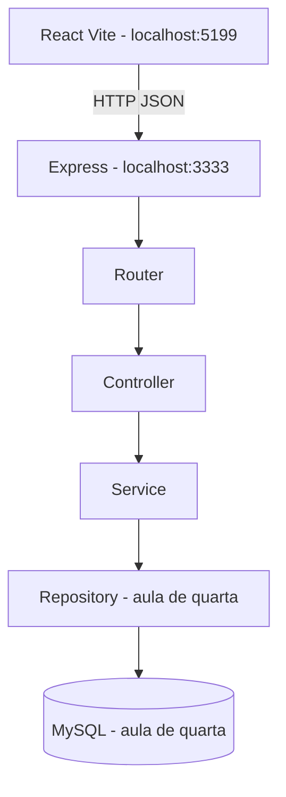

# Plano didático — Semana de 19 a 24 de outubro de 2026

## Objetivo
Conservar o React/TypeScript original e reconstruir o backend em aula, **em camadas**. Na Aula 01, já estão implementadas as rotas /health e /api/v1/info, com middlewares de 404/500.

| Dia | Aula | Entrega |
| --- | --- | --- |
| Segunda (19/10) | Arquitetura e API | GET /health; GET /api/v1/info; 404 JSON |
| Terça (20/10) | TypeScript e Zod | tipos, interfaces, DTOs e validações |
| Quarta (21/10) | MySQL e Prisma | conexão, models e migrations |
| Quinta (22/10) | REST de clientes | rotas GET e POST integradas a camadas e banco |
| Sexta (23/10) | Testes | suites de serviços e rotas |
| Sábado (24/10) | Docker e CI/CD | compose e GitHub Actions |

## Contratos esperados para desenvolvimento futuro

**Ainda não estão implementadas:** /api/v1/auth/login, /api/v1/customers, /api/v1/appointments e outras chamadas presentes no frontend/src/lib/api.ts.

## Regras de domínio que serão trabalhadas depois

- Um profissional não deve ter agendamentos ativos sobrepostos.
- Procedimentos e profissionais podem possuir durações distintas.
- Operações sensíveis exigirão autenticação/autorização.
- O sistema não terá checkout ou pagamento online; somente registros administrativos.
- Evitar usar dados reais de pacientes em aula.
